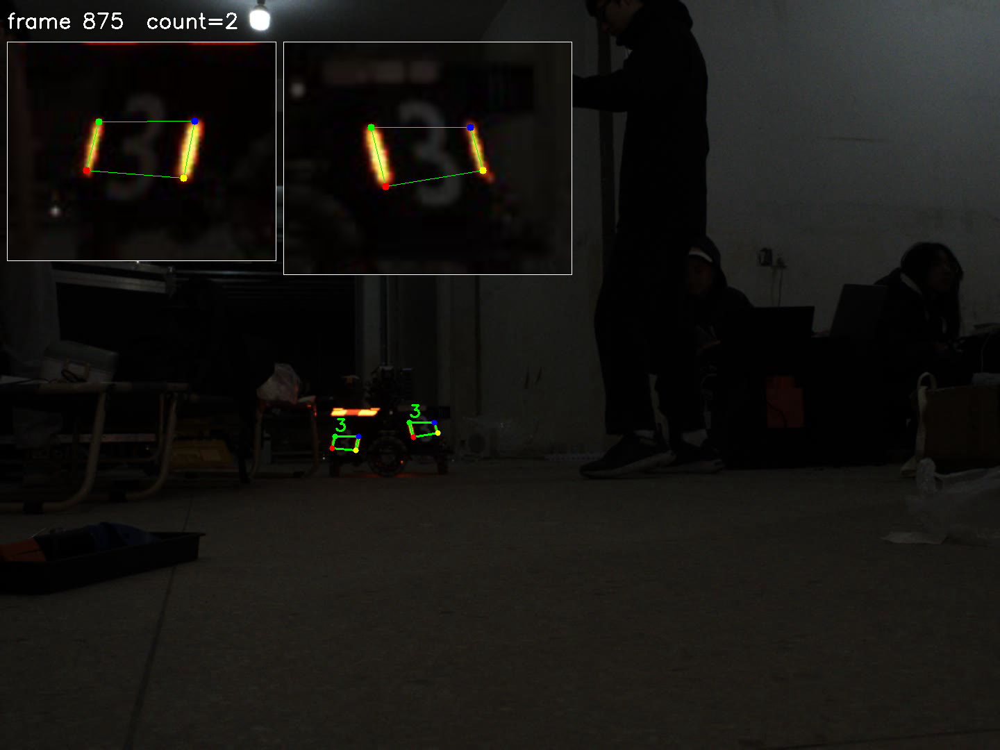
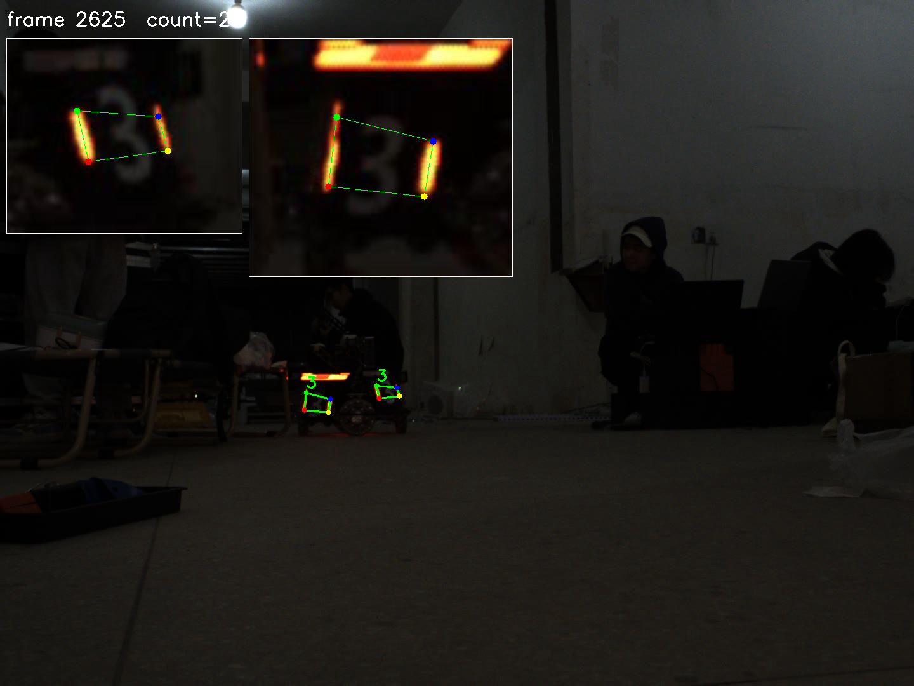

# 装甲板检测（RM 自瞄考核）

读取视频，检测敌方装甲板：灯条查找 → 装甲板匹配 → 数字识别，逐帧写入结果文件。

- 输入：`video/3.avi`（2209 帧）、`video/4.avi`（3416 帧），1440×1080 @25fps
- 输出：`3.txt`、`4.txt`（每帧一行）
- 实测性能：Linux 6.8–7.8 ms/帧（128–148 fps，随机器负载波动）、Windows 7.0 ms/帧（≈143 fps），单线程 CPU，满足 25 fps 实时要求
- 实测平台：Ubuntu 26.04.1 LTS + OpenCV 4.10.0、Windows 11 + OpenCV 4.14.0（结果逐点一致）

## 快速开始

```bash
sudo apt install -y build-essential cmake pkg-config libopencv-dev python3-opencv
cmake -S . -B build -DCMAKE_BUILD_TYPE=Release && cmake --build build -j"$(nproc)"
./build/start video/3.avi red --headless          # 生成 3.txt
python3 tools/check_result.py 3.txt video/3.avi   # 自检
```

提交包不含视频，先把 `3.avi` / `4.avi` 放进 `video/`。

## 效果

| 3.avi 第 875 帧（同一帧两块） | 4.avi 第 2625 帧（斜对相机） |
| --- | --- |
|  |  |

图中绿框由结果 txt 反渲染得到（不是检测时画的），角点四色：左下红、左上绿、右上蓝、右下黄；左上角为 4 倍放大图。

## 目录结构

| 路径 | 作用 |
| --- | --- |
| `start.cpp` | 主流程：读帧 → 检测 → 分类 → 写文件 → 可视化 |
| `Armor/src/ArmorDetector.cpp` | **本次实现**：`FindLight`、`FindArmor`、`WriteFrameResult` |
| `Armor/include/ArmorTypes.h` | 灯条 / 装甲板数据结构（未改动） |
| `io/` | `VideoReader` 封装（未改动） |
| `model/mlp.onnx`、`model/label.txt` | 数字分类模型与标签（未改动） |
| `tools/check_result.py` | 结果自检脚本（行数/帧号/格式/坐标/统计），任务书 §8.1 |
| `tools/render_check.py` | 把 txt 四点反渲染回视频帧，生成人工抽检图，任务书 §8.2 |
| `tools/check_result.cpp` | 等价的 C++ 版（自检 + `--render-every` 反渲染），随 CMake 一起构建 |
| `verify/` | 由 txt 反渲染出的抽检图（每 5 秒 1 帧）+ 数字图拼图 `*_numbers.png` |
| `results_alt/` | 两条视频的 literal 格式结果（备用，主结果仍是根目录的 `3.txt`/`4.txt`） |
| `.github/workflows/ci.yml` | GitHub Actions：Ubuntu 构建（0 warning）+ 合成视频跑通两种格式 |
| `requirements.txt` | Python 工具依赖（opencv-python、numpy） |
| `build/` | 构建产物（自动生成） |

## 环境

实测通过的环境：

| 项 | 版本 |
| --- | --- |
| 系统 A | Ubuntu 26.04.1 LTS（x86_64，8 核） |
| 编译器 A | g++ 15.2.0 |
| 构建 A | CMake 4.2.3 |
| OpenCV A | 4.10.0（Ubuntu 包 `4.10.0+dfsg-7ubuntu5`，`pkg-config --modversion opencv4` 实测） |
| Python A | 3.14.4 + opencv-python 4.10.0 + numpy 2.3.5（跑自检脚本） |
| 系统 B | Windows 11（VS 18 2026 Community） |
| 编译器 B | MSVC 14.51.36231（x64） |
| 构建 B | CMake 4.3.1（VS 自带），生成器 `Visual Studio 18 2026` |
| OpenCV B | 4.14.0（官方 Windows 预编译包，`build/x64/vc16`） |

两套环境的输出逐点一致（5625 行、最大坐标差 0.000000 px，仅行尾 CRLF/LF 不同），见 `RESULTS.md` §4。

## 构建

### Windows

```powershell
# 1) 解压 OpenCV 4.14.0 到 C:\opencv（得到 C:\opencv\opencv\build）
#    https://github.com/opencv/opencv/releases/download/4.14.0/opencv-4.14.0-windows.exe
$cmake = "C:\Program Files\Microsoft Visual Studio\18\Community\Common7\IDE\CommonExtensions\Microsoft\CMake\CMake\bin\cmake.exe"
& $cmake -S . -B build -G "Visual Studio 18 2026" -A x64 -DOpenCV_DIR=C:/opencv/opencv/build
& $cmake --build build --config Release -j

# 2) 运行时 DLL
$env:Path = "C:\opencv\opencv\build\x64\vc16\bin;" + $env:Path
```

### Linux

```bash
sudo apt update && sudo apt install -y build-essential cmake pkg-config libopencv-dev python3-opencv
cmake -S . -B build -DCMAKE_BUILD_TYPE=Release
cmake --build build -j"$(nproc)"
# 产物：build/start、build/check_result
```

实测（Ubuntu 26.04.1，干净目录）：`cmake` configure 0 error、`cmake --build` 0 error / 0 warning，`build/start` 与 `build/check_result` 正常生成。

### 持续集成

`.github/workflows/ci.yml` 在每次 push / PR 时于 `ubuntu-24.04` 上执行：

1. 安装 `libopencv-dev`、`python3-opencv`；
2. 配置 + 构建，并检查构建日志里 **0 条 warning**；
3. 用 50 帧合成全黑视频跑 canonical 与 literal 两种格式：行数必须 = 50、全部 `count=0`，再跑 `check_result.py`；
4. 验证非法 `--format xml` 会报错退出。

仓库不含真实视频（100–160 MB），CI 只验证"能构建、能跑通、格式对"，精度指标以本机结果为准。

## 运行

```bash
# 用法
./build/start <视频> [red|blue] [--headless] [--save-every N] [--save-list 帧号,...] [--max-frames N] [--dump-numbers N] [--format canonical|literal] [--verbose]

# 生成结果（在仓库根目录执行，输出 3.txt / 4.txt）
./build/start video/3.avi red --headless
./build/start video/4.avi red --headless

# 自检（任务书 §8.1）与反渲染抽检（§8.2）
python3 tools/check_result.py 3.txt video/3.avi
python3 tools/check_result.py 4.txt video/4.avi
python3 tools/render_check.py 3.txt video/3.avi --every 125 --out verify
python3 tools/render_check.py 4.txt video/4.avi --every 125 --out verify
```

> 提交包按任务书要求不含视频：先把 `3.avi`/`4.avi` 放进 `video/` 再运行上面的命令。
> Python 工具依赖：`python3 -m pip install -r requirements.txt`（或装系统包 `python3-opencv`）。

| 参数 | 说明 |
| --- | --- |
| `red` / `blue` | 敌方颜色，默认 `red` |
| `--headless` | 不开窗口、不 `waitKey`，用于批量/无显示器环境。Linux 下没有 `DISPLAY`/`WAYLAND_DISPLAY` 时自动启用 |
| `--save-every N` | 每 N 帧保存一张带框的调试图到 `debug/` |
| `--save-list a,b,c` | 仅保存指定帧号的调试图 |
| `--max-frames N` | 只处理前 N 帧（调试用） |
| `--dump-numbers N` | 每 N 帧收集分类后的数字图，结束时拼成 `verify/<视频名>_numbers.png`（标注帧号/数字/置信度）；与 `--save-list` 同用时，列表中的帧还会附上被 `Classify` 删除的候选（红字 `DROP`） |
| `--verbose` | 每 25 帧打印灯条数/匹配数/最终数 |
| `--format` | `canonical`（默认，任务书 §7 写法）或 `literal`（按 `Homework.md` 原句写法），见“输出格式” |

调试开关（环境变量）：

- `ARMOR_SAVE_MASK=<起始帧>`：保存该帧起 6 张灯条掩码到 `debug/`。

自检脚本说明：

- `check_result.py` 输出 8 项 `PASS/FAIL`（行数=帧数、帧号连续、每行可解析、count 一致、每块 4 点、坐标在画面内、四点不退化、number 合法）与统计，最后一行 `RESULT: PASS/FAIL`，退出码 0/1 可直接进 CI。默认自动识别 canonical/literal，也可用 `--format` 强制。
- `render_check.py` 按 `--every N` 抽样（空帧也渲染），角点按顺序着色（0 红=左下 / 1 绿=左上 / 2 蓝=右上 / 3 黄=右下），左上角附 4 倍放大图；同样自动识别两种格式（实测两种格式渲染出的 PNG 逐字节相同）。
- 两个 Python 脚本在 Linux 上实测（Python 3.14.4 + cv2 4.10.0）。另有 C++ 版 `build/check_result`（额外支持 `--render-every`，**只解析 canonical**），Windows 无 Python 环境时可用。

## 算法

### 1. 灯条查找（`FindLight`）

1. 分离 BGR 通道，取通道差：红灯 `R-B`，蓝灯 `B-R`。
   不用 HSV 的原因：灯条中心过曝成白/黄（实测 R=G=255、B≈100），色相会漂到 40° 以上，而 B 通道仍然很低，差值稳定。
2. 阈值二值化（默认 70）→ 3×3 开运算去噪 → 3×3 闭运算 2 次连接断裂。
3. `findContours` + `minAreaRect`，按下列判据过滤：

| 判据 | 取值 |
| --- | --- |
| 长边 | ≥ 8 px |
| 长宽比 | 1.6 ~ 12 |
| 轮廓面积 / 外接矩形面积 | ≥ 0.40 |
| 长轴与水平夹角 | 45° ~ 135°（相对竖直 ±40°） |
| 灯条数量 | 超过 40 条时按长度截断 |

### 2. 装甲板匹配（`FindArmor`）

两两配对，全部满足才认为是装甲板：

| 判据 | 取值 |
| --- | --- |
| 两灯条长轴夹角 | ≤ 12° |
| 长度比 | ≤ 1.7 |
| 中心 y 差 / 平均灯条长 | ≤ 0.6 |
| 内间距 / 平均灯条长 | 0.15 ~ 3.2 |
| 装甲板宽高比 | 1.1 ~ 5.0 |
| 宽高比 ≥ 3.0 | 判为 LARGE，否则 SMALL |

四点取两条灯条**长轴的上下端点**（`LightBlob::top/bottom`），顺序固定为 **左下 → 左上 → 右上 → 右下**：

```
points = { left.bottom, left.top, right.top, right.bottom }
```

`ExtractNumbers` 的透视变换依赖这个顺序（写反会导致数字镜像），而且它把灯条端点映射到 28 px 高图里的 12 px 灯条位置，用端点正好对得上。同帧重复框按中心距去重。

> 调试记录：最初版本是“8 个角点按 x 排序，取最左/最右各两个”。灯条细且稍有倾斜时，最左两个角点可能都是**上端**角点，四边形自交，数字图被扭成乱码，`Classify` 把它删掉——表现为“两块装甲板都清楚可见却输出 count=0”（例如 3.avi 第 875 帧）。改用长轴端点后，有目标帧占比 3.avi 92.1% → 96.1%、4.avi 87.8% → 97.3%，`outpost` 误判 17 → 0。详见 `RESULTS.md`。

### 3. 数字识别

沿用模板提供的 `ExtractNumbers` + `Classify`（ONNX，阈值 0.7，忽略 `negative`），未改动判定逻辑。

## 输出格式

程序支持两种格式，用 `--format` 选择，**默认 canonical**。

### canonical（默认，任务书 §7）

```
<帧号>, count=<N>[, armor1: number=<数字>, points=(x,y),(x,y),(x,y),(x,y)][ | armor2: ...]
```

```
0, count=0
1, count=1, armor1: number=3, points=(520.53,647.13),(522.30,625.94),(571.50,626.00),(571.50,647.00)
```

### literal（`--format literal`，贴近 `Homework.md` 原句）

```
<帧号>[，装甲板1: <数字>, points: (x,y),(x,y),(x,y),(x,y)][ | 装甲板2: ...]
```

```
26
0，装甲板1: 3, points: (520.19,647.09),(521.81,625.91),(571.50,626.00),(571.50,647.00)
0，装甲板1: 3, points: (586.57,625.09),(589.46,607.74),(623.50,606.00),(623.50,625.00) | 装甲板2: 3, points: (699.00,641.00),(699.00,624.00),(729.35,625.73),(732.04,639.19)
```

第一行是空帧（只写帧号），第三行是同一帧两块装甲板（取自 4.avi）。

两种格式的共同约定：

- 一帧一行，行数等于视频帧数；无目标帧在 canonical 下是 `<帧号>, count=0`，在 literal 下只有帧号。
- 坐标保留 2 位小数，原点为左上角；四点顺序固定为左下、左上、右上、右下。
- 数字取值 `1|2|3|4|outpost|guard|base|unknown`。

> 为什么有两种：`Homework.md` 原句是“帧号，装甲板1:armor_number2.points:4个点”，本身有笔误且没有官方样例。默认 canonical（字段自解释、可稳定解析），literal 按原句逐字排版，评审若要求另一种写法，重新跑一遍即可（`--format literal`），代码逻辑不变。`results_alt/` 里放了两条视频的 literal 结果备查。

## 结果

见 `RESULTS.md`。两条视频均通过自检（Ubuntu 26.04 + OpenCV 4.10.0 实测）：

```bash
python3 tools/check_result.py 3.txt video/3.avi
python3 tools/check_result.py 4.txt video/4.avi
```

```
3.txt: 2209 行 = 2209 帧 | 有目标 2122 帧 (96.06%) | 2372 块 | 最长全 0 段 8 帧 | PASS
4.txt: 3416 行 = 3416 帧 | 有目标 3323 帧 (97.28%) | 3869 块 | 最长全 0 段 8 帧 | PASS
```

`check_result.py` 检查：行数 = 视频帧数、帧号从 0 连续、每行可解析、`count` 与条目数一致、每块 4 点、坐标在画面内、四点面积非 0、`number` 在允许集合内；并输出有目标帧占比、最长全 0 段、相邻帧 count 最大跳变、数字分布。`render_check.py` 把 txt 里的点画回原视频（空帧也画），角点按顺序着色（0 红 / 1 绿 / 2 蓝 / 3 黄），左上角附 4 倍放大图。

> 说明：任务书同时要求 C++ 主程序与 Python 自检脚本。两个 Python 工具按 §8.1/§8.2 实现并在 Linux 实测；另保留 C++ 版 `build/check_result`（额外支持 `--render-every`），在没装 Python/opencv-python 的 Windows 机器上也能复现同一套检查。

## 相对模板的改动

| 文件 | 改动 |
| --- | --- |
| `Armor/src/ArmorDetector.cpp` | 实现 `FindLight`、`FindArmor`；重写 `WriteFrameResult`；阈值 180 → 70 |
| `start.cpp` | 恢复 `ExtractNumbers`/`Classify` 调用；新增 `--headless`、`--dump-numbers`、`--format` 等参数；无显示器自动 headless；输出统计 |
| `Armor/include/ArmorDetector.h` | 新增 `SetOutputFormat()` 与 `output_format_`（不改动原有字段/签名） |
| `CMakeLists.txt` | 增加 `imgcodecs` 组件、MSVC `/utf-8`、`check_result` 目标 |
| `tools/check_result.cpp` | 新增 C++ 版自检/反渲染工具 |
| `tools/check_result.py` | 新增 Python 版自检工具（任务书 §8.1，Linux 实测） |
| `tools/render_check.py` | 新增 Python 版反渲染抽检工具（任务书 §8.2，Linux 实测） |
| `README.md` | 重写 |

`ArmorTypes.h`、`io/`、`model/`、`ExtractNumbers`、`Classify` 均未改动。

## 已知限制

1. 两条视频里出现的只有 3 号步兵，所以数字识别只在“3”上验证过，其它数字没有样本。
2. 机器人正侧对相机时，每块装甲板只露出一条灯条，无法配对，会漏检（两条视频最长连续漏检均为 8 帧，约 0.3 s，已抽帧确认属于这种情况）。
3. 判别阈值按本批暗光视频标定；换场地/曝光需要重调 `threshold_` 与灯条/配对参数。
4. 灯条倾角限制在竖直 ±40° 以内（`kMaxTiltDeg`），装甲板滚转更大时不会被检测。
5. 已在 Ubuntu 26.04.1 + OpenCV 4.10.0（GCC 15.2.0）与 Windows 11 + OpenCV 4.14.0（MSVC 14.51）两套环境实测；Linux 的自动 headless 分支用 `env -u DISPLAY -u WAYLAND_DISPLAY ./build/start video/3.avi red` 验证过（自动打印"未检测到 DISPLAY，自动启用 --headless"）。
6. 尚未在 Ubuntu 20.04/22.04 的 OpenCV 4.5/4.2 上验证；两份结果的一致性说明当前代码只用了 OpenCV 4.x 的稳定 API，但低版本未实测。
