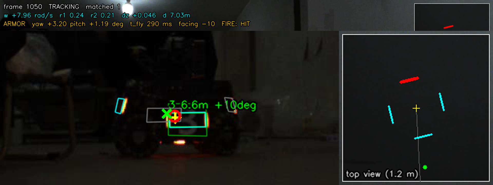

# RM Auto-Aim (视觉自瞄) — detection → pose → whole-robot EKF → ballistics → fire

A complete, self-contained RoboMaster armor auto-aim pipeline in C++17 + OpenCV
(no ROS, no Eigen). It was built by studying the best-known open-source RM
vision projects, re-implementing their strongest ideas, and then measuring
every change on the two recorded videos (place them at `../video/3.avi` and
`../video/4.avi` in this combined repository) and on a
ground-truth simulator.

```
frame ─► Detector ─────────► PoseSolver ─────────► RobotTracker ───────► RobotAimer ──► gimbal cmd + fire
         R−B lights           IPPE PnP              11-state EKF           latency + flight-time
         pair + contain chk   fixed-pitch yaw       (centre, v, yaw, ω,    iteration, armor choice,
         PCA corner refine    search                 r1, r2, dz)           ballistics with drag,
         MLP digit (ONNX)     yaw self-calibration   multi-armor assoc.    fire gating
```

## Results

Two real videos (1440×1080, 25 fps, the same red infantry robot "3"), plus
eight simulated scenarios with exact ground truth. **Hit rate** = hits /
verifiable shots; **hits/s** = hits per second of video (the damage output).

### Real videos: virtual shooting

| strategy | video 3 hit rate | video 3 hits/s | video 4 hit rate | video 4 hits/s |
|---|---|---|---|---|
| direct (aim at the current plate, no prediction) | 35.5% | 7.4 | 56.7%* | 11.8 |
| point KF (constant-velocity predictor on the plate) | 29.6% | 5.5 | 43.1% | 3.5 |
| **robot EKF (this system)** | **62.5%** | **9.0** | **59.6%** | **8.2** |
| oracle (cheats: aims at the plate seen at impact time) | 99.3% | 22.4 | 93.8% | 22.0 |

\* At video 4's spin rate (8.3 rad/s) the 0.33 s lead is ≈ 155°, so "aim where a plate
is now" often meets the *next* plate. That's aliasing luck at one speed: in the
simulator at 10 rad/s, direct scores 43% and the robot EKF 99.6%.

The oracle shows the evaluation's own ceiling (detector and judge noise).

**Prediction error** (median px between the predicted and the observed plate
centre; the plate's half-width is about 24 px):

| horizon | no prediction | point KF | robot EKF |
|---|---|---|---|
| video 3, 0.12 s | 27.4 | 9.7 | **5.1** |
| video 3, 0.20 s | 44.1 | 29.4 | **9.1** |
| video 3, 0.32 s | 39.0 | 66.5 | **16.2** |
| video 4, 0.20 s | 23.1 | 91.2 | **12.8** |
| video 4, 0.32 s | 44.5 | 85.2 | **19.3** |

**Recovered robot geometry.** The two videos are independent recordings, and the
tracker recovers the same robot from both:

| | r1 | r2 | dz (2nd pair height) | median ω |
|---|---|---|---|---|
| video 3 | 0.243 m | 0.208 m | 0.050 m | 2.6 rad/s, direction-changing |
| video 4 | 0.239 m | 0.213 m | 0.046 m | 8.3 rad/s |

### Simulator (ground truth)

`autoaim_sim`: 0.7 px corner noise, 5% detection drop-out, 25 fps, 60 ms latency, 25 m/s.

| scenario | direct | point KF | **robot EKF** | robot hits/s | centre err | ω err |
|---|---|---|---|---|---|---|
| spin 2.1 rad/s at 5 m (like the videos) | 42.3% | 97.5% | **100.0%** | 15.0 | 3.7 cm | 0.21 rad/s |
| fast spin 10 rad/s at 4 m | 43.2% | 37.0% | **99.6%** | 14.1 | 2.1 cm | 0.14 |
| spin 4 rad/s, approaching 7 → 3 m | 51.8% | 44.4% | **100.0%** | 13.9 | 3.2 cm | 0.19 |
| variable spin 0.5–4.5 rad/s at 6 m | 69.9% | 73.2% | **99.7%** | 14.5 | 4.5 cm | 0.26 |
| swing back and forth ±3 rad/s | 64.4% | 88.7% | **100.0%** | 17.0 | 4.5 cm | 0.25 |
| spin 3 rad/s + gentle strafe 0.3 m | 74.9% | 67.0% | **88.0%** | 13.2 | 4.3 cm | 0.29 |
| spin 6 rad/s + hard strafe 0.5 m / 2 s | 53.6% | 14.6% | 41.8% | 5.3 | 3.2 cm | 0.70 |
| no spin, hard strafe 0.8 m / 2 s | 14.0% | 24.5% | 19.1% | 2.5 | 7.5 cm | 1.34 |

The last two rows are open problems (see "Limitations"): their sideways
acceleration is 5–8 m/s². Over a 0.33 s lead, a constant-velocity prediction is
then off by 0.27–0.43 m, which is several plate widths.

### Timing (single thread, Windows, MSVC Release)

| stage | ms / frame |
|---|---|
| detector (incl. MLP digit) | 3.6 |
| pose (PnP + yaw search) | 0.8–1.0 |
| tracker + aimer + 3 baselines + judge | 0.4 |

That is ≈ 5 ms per 1440×1080 frame, ~200 fps headroom.



*Video 4, frame 1050. Green: detection and panel outline. Cyan: model plates facing
the camera (grey: turned away). Yellow +: robot centre. Red ○: aim point at
impact time. Green ×: where the virtual bullet landed (a hit). Top view (right):
the red plate is the one chosen for impact, the back plate now, which will have
rotated to the front 0.35 s later.*

## Baseline snapshot

Every number in this README is frozen in [`BASELINE.md`](BASELINE.md), together with the exact
environment (OS / MSVC / OpenCV / commit), the commands to reproduce it, and the raw outputs in
[`reports/`](reports/). Regression thresholds live in the same file.

> Measured: the two-video evaluation is bit-for-bit reproducible (3.avi 62.5%, 4.avi 59.6%);
> the simulator drifts by up to 3 percentage points across OS/OpenCV versions, so compare it only
> on the same machine + same binary.

## What was taken from where

| idea | source (license) | here |
|---|---|---|
| light/pair geometry tests, IPPE PnP, MLP digit classifier, tracker state machine | [chenjunnn/rm_auto_aim](https://github.com/chenjunnn/rm_auto_aim) (MIT) | `detector.cpp`, `pose.cpp`, `tracker.cpp` |
| whole-robot EKF (centre + yaw + radius) | rm_auto_aim; [FaterYU/rm_auto_aim](https://github.com/FaterYU/rm_auto_aim) (MIT) | extended to 11 states |
| second-pair height `d_z`, best-armor selection with `side_angle`, centre tracking when spinning fast, fire tolerance | [CSU-FYT-Vision/FYT2024_vision](https://github.com/CSU-FYT-Vision/FYT2024_vision) (Apache-2.0) | `tracker.cpp`, `aimer.cpp` |
| PCA symmetry-axis corner refinement | FYT2024 `light_corner_corrector` | `Detector::refineCorners` |
| fixed-pitch yaw optimisation (FYT's BA idea) | FYT2024 `ba_solver` | 1-D search, no g2o |
| projectile with air drag | [robomaster-oss/rmoss_core](https://github.com/robomaster-oss/rmoss_core) (Apache-2.0), FYT `trajectory_compensator` | full RK4 integration |
| `LightBlob`-style template, R−B colour | [xinyang-go/SJTU-RM-CV-2019](https://github.com/xinyang-go/SJTU-RM-CV-2019) (MIT) via our assessment | detector |
| adaptive EKF, particle filter | SJTU CVRM2021, TUP-InfantryVision-2022 (GPL-3) | ideas only, no code |

All code here was written for this project; no file was copied. The
number-extraction warp follows the template's (rm_auto_aim lineage) exactly,
because the bundled `model/mlp.onnx` was trained with it.

### Beyond the references

1. **11-state EKF with multi-armor association.** Each detection is matched
   (Mahalanobis gate) to whichever of the 4 model plates it is closest to. Both
   radii and the height offset are filter states. Two plates seen in one frame
   are fused sequentially. No hand-written "armor jump" logic is needed.
2. **Anisotropic measurement noise.** Across the viewing ray, σ = d·px/f; along
   the ray, σ = d·px/bar_px (about 10× worse: depth comes from apparent size).
3. **Yaw self-calibration from the data itself.** Two plates of one robot seen
   in the same frame must be 90° apart. The measured separation was 69.3° (video 3,
   248 frames) and 69.7° (video 4, 542 frames): bar glow makes oblique plates look
   too wide. `yaw_gain = 1.3` corrects this; afterwards the separation is 89–91°.
4. **Adaptive process noise.** An EMA of the position-innovation NIS scales the
   centre's process noise, so the centre stays stiff while the robot spins in
   place and loosens when it manoeuvres. This is the largest single gain on the
   videos.
5. **Wrapped yaw residuals, Joseph-form covariance update**, and a fix of the
   `q_y_vy` typo in the reference Q matrix.
6. **An evaluation harness that can say "better"** (below).

## Evaluation method

* **Virtual shooting on real video.** Every frame, each strategy commands a
  simulated gimbal (first-order lag τ = 30 ms, 12 rad/s limit) and decides
  whether to fire. A shot leaves after the latency, flies with drag, and is judged
  against the **future** frames. Plates are interpolated to the exact impact
  time, the bullet is intersected at each plate's range, and the shot is a hit if
  the impact point projects inside that plate's panel outline. Shots whose impact
  time has no detected plate count as unverifiable.
* **Oracle.** The same judge with an aimer that looks up the future plate. This
  gives the metric's own ceiling (99% / 94%).
* **Prediction error.** The predicted plate centre vs the plate observed 0.12 /
  0.20 / 0.32 s later, on the same samples for all three methods.
* **Simulator.** A spinning, strafing 4-plate robot with two radii and heights
  is rendered through the same camera model with noise and drop-outs, and fed
  through the same pose solver and trackers. Shots are judged against the exact
  plate geometry.

## Build & run

### Camera calibration for a physical robot

`config/default.yaml` contains assumed intrinsics for the supplied recordings. To
use a physical camera, capture at least 12 sharp chessboard images with that same
camera, lens, focus, zoom, and resolution. Move and tilt the board across the
frame; measure the square size. Then run:

```bash
python3 tools/calibrate_camera.py 'calibration/*.png' --cols 9 --rows 6 \
  --square-mm <measured_mm> --out config/camera.yml
./build/autoaim_video recording.avi --camera config/camera.yml --out out_calibrated
```

The calibration tool requires Python OpenCV and NumPy. It reports per-view
reprojection errors and frame coverage; inspect those results and repeat poor
views. `--camera` loads the measured intrinsics and distortion without changing
the detector/tracker configuration, and refuses videos with a different
resolution. Keep the original `config/default.yaml` and assessment outputs.
Measure camera-to-gimbal rotation and translation separately before using world
coordinates or ballistics on a robot. `--pitch-deg` records a measured downward
camera tilt when available; its default of zero is only a placeholder.

The supplied 3.avi and 4.avi lack a calibration capture. Running the tool on
images from another camera would not calibrate those recordings.

### Build and evaluation

`autoaim_video` reads the recording's FPS metadata for timestamps, tracking,
prediction horizons, virtual shots, and output video. When metadata is absent or
invalid, it uses `eval.fps` from the config. A cached detection file with the
wrong frame count is regenerated; valid cached detections are retimed to the
recording's FPS before evaluation.

Requirements: CMake ≥ 3.16, a C++17 compiler, OpenCV 4 (core, imgproc,
imgcodecs, videoio, highgui, calib3d, dnn).

```bash
# Linux
cmake -S . -B build && cmake --build build -j
./build/autoaim_tests
./build/autoaim_sim
./build/autoaim_video ../video/3.avi --out out --render 300:450
```

```powershell
# Windows (VS 2026 + OpenCV 4.14 prebuilt in C:\opencv\opencv)
$cmake = "C:\Program Files\Microsoft Visual Studio\18\Community\Common7\IDE\CommonExtensions\Microsoft\CMake\CMake\bin\cmake.exe"
& $cmake -S . -B build -G "Visual Studio 18 2026" -A x64 -DOpenCV_DIR=C:/opencv/opencv/build
& $cmake --build build --config Release -j
$env:Path = "C:\opencv\opencv\build\x64\vc16\bin;" + $env:Path
.\build\Release\autoaim_video.exe ..\video\3.avi --out out --render 300:450
```

`autoaim_video` options:

| option | |
|---|---|
| `--config f.yaml` | parameters (default `config/default.yaml`) |
| `--out dir` | outputs: `<video>_report.md`, `<video>_track.csv` (per-frame state, command, shot), `<video>_yawdiag.csv`, `<video>_pairdiag.csv`, overlay video/PNGs |
| `--redetect` | ignore the detection cache `<out>/<video>_detections.txt` |
| `--render A:B` | overlay video of frames A..B |
| `--set key=value` | override a parameter (names in `src/config.cpp: setParam`) |
| `--sweep key=v1,v2,...` | re-run pose + tracking + shooting for each value (detections are reused; ~3 s per value) |

`autoaim_sim` options: `--fps --noise --dropout --seconds --set key=value`.

## Tuning log (all numbers from the sweeps)

Ablation on the real videos, adding one change at a time. Robot-EKF hit rate,
with the median prediction error at 0.32 s in brackets:

| step | video 3 | video 4 |
|---|---|---|
| A first working version | 51.2% (18.6 px) | 49.6% (21.7 px) |
| B + yaw self-calibration | 51.8% (18.0) | 49.4% (21.9) |
| C + measured yaw noise (σ ≈ 6°) | 53.6% (17.8) | 50.0% (22.5) |
| D + stiff centre + adaptive Q | 56.3% (16.2) | 54.2% (19.3) |
| E + fire only at plates within 30° (final) | **62.5%** (16.2) | **59.6%** (19.3) |

Other findings:

* **Fire window** trades efficiency for volume. On video 3: 15° → 69% / 6.3 hits/s,
  30° → 63% / 9.0, 50° → 58% / 10.7.
* **Centre mode** (aim at the centre, fire as plates pass) was *not* better than
  armor mode at 25 fps with this gimbal model, even at 10 rad/s with a slow
  gimbal (τ = 80 ms: 98.1% vs 99.4%). It switches on only above 12 rad/s.
* **Covariance fire gate** (`fire_sigma_scale`): implemented but off. Q is tuned
  for responsiveness, so the propagated covariance is not a calibrated
  uncertainty, and the gate blocked almost every shot.
* **Camera pitch** (−6…+6°) and **armor pitch** (8…22°) barely matter. Pitch 0°
  for the armor is clearly worse (44% vs 51%).
* **The focal length cannot be calibrated from these videos.** A smaller fx makes
  every shot look easier (closer target, shorter flight), while the model-consistency
  signals (prediction error, radius) stay flat. fx = 2400 px (8 mm lens on a
  1440×1080 / 3.45 µm sensor) is an assumption: **calibrate the real camera.**
* The video-3 robot **reverses its spin direction** several times (frames
  ≈ 270–380, 550–680, 1250–1350; visible in the raw plate motion). This
  direction-changing, variable-speed spin is why its ceiling is lower than a
  steady spinner's.

## Limitations / next steps

1. **Camera calibration.** Intrinsics are assumed (see above), and the camera is
   treated as fixed at the gimbal origin. A real robot needs the camera→gimbal
   extrinsics and the IMU attitude at capture time (the world frame here is
   already gravity-aligned, so this is one extra rotation).
2. **Hard strafing** (≥ 5 m/s²) defeats any constant-velocity model at 0.33 s
   lead. Next options: a constant-acceleration / IMM model (FaterYU lists CA
   as a planned change), or aiming at the middle of the strafe.
3. **25 fps video.** A real camera at 100–200 fps would cut prediction noise
   considerably. The tracker and aimer are time-stamped and frame-rate independent.
4. **Not included:** serial protocol to the MCU, ROS 2 nodes, energy-mechanism (buff)
   aiming, and number-model retraining (only "3" appears in the videos).
5. The gimbal model is a simple first-order lag. Measure the real latency and
   step response, then set `latency`, `gimbal_tau` and `gimbal_max_rate`.

## Layout

```
include/autoaim/  types, config, detector, pose, tracker, ballistics, aimer, evaluation, draw
src/              implementations
apps/             autoaim_video (real video + evaluation), autoaim_sim (ground-truth simulator)
tests/            unit tests (ballistics, PnP round trip, EKF convergence)
config/           default.yaml (every tuned value is commented)
model/            mlp.onnx + label.txt (digit classifier from the team template)
docs/             figures
```
